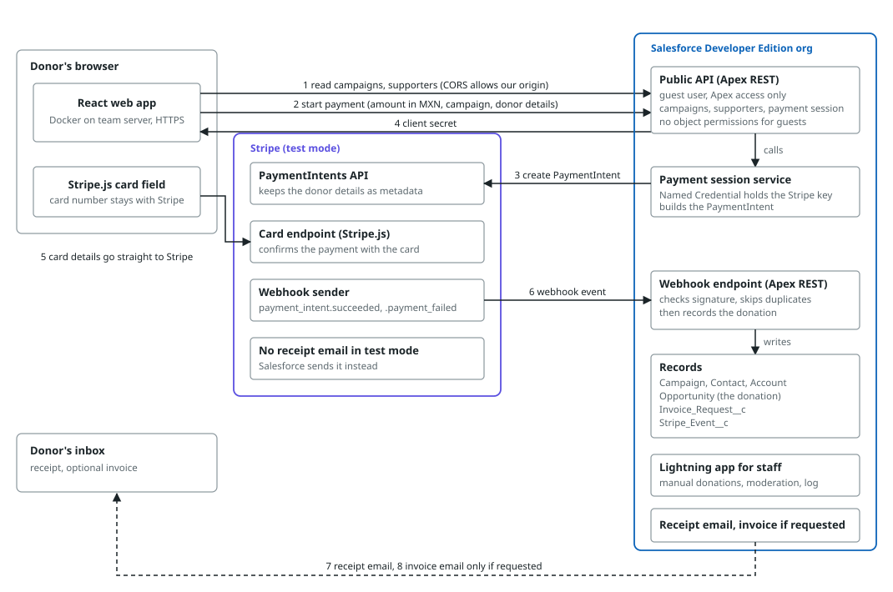
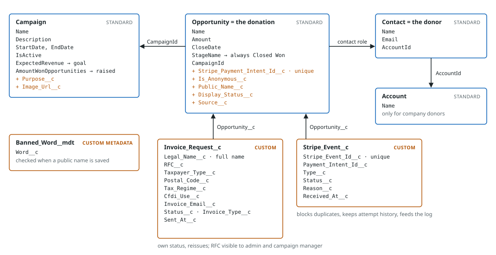

# Architecture — Mexico Dreamin Donation Portal

The overview every contributor and agent reads before building. It holds the two diagrams the team agreed on: the services, and the data model mapped to Salesforce objects. The detail behind them (metadata keys, webhook steps, field list, decisions) is in [requirements/architecture/solution-architecture.md](requirements/architecture/solution-architecture.md). What is and is not built is in [scope.md](scope.md). How Salesforce serves the API (site, Guest User, Apex REST classes, CORS, webhook, Stripe callout) is in [salesforce-api.md](salesforce-api.md).

If a change contradicts this page, update the page and `docs/requirements/architecture/solution-architecture.md` in the same pull request.

## 1. Services

A React web app on the team's server shows the site. Salesforce is the backend and the database. Stripe takes the card and tells Salesforce when a payment succeeded.

*Solid arrows are calls; dashed arrows are emails. Salesforce talks to Stripe only through a Named Credential, and Stripe talks back only through the webhook.*

| Service | Role | Hosting |
| :--- | :--- | :--- |
| React web app | Donor-facing site in Spanish. Shows campaigns and supporters, collects donor details, shows the Stripe card field. | Docker on a team-owned server, own domain, certbot TLS. Approved by the professor. |
| Salesforce Developer Edition | Public API (Apex REST, Guest User), payment sessions, webhook endpoint, emails, staff Lightning app. | Salesforce |
| Stripe (Test Mode) | Takes the card, confirms the payment, sends the webhook. Currency MXN. | Stripe |

### Payment flow
1. The web app asks the public API for open campaigns and the supporters list.
2. The donor fills in the form. The app asks for a payment session with amount, campaign, recognition choice, invoice choice and donor details.
3. Salesforce validates the data, creates a Stripe PaymentIntent and stores the donor details in its metadata. No donation record exists yet.
4. Salesforce returns the client secret.
5. The card field sends the card to Stripe. Salesforce never sees card data.
6. Stripe posts `payment_intent.succeeded` to the webhook endpoint. Salesforce checks the signature, ignores events it already logged, and creates the donation, plus an invoice request when one was made.
7. Salesforce emails the receipt, because Stripe sends none in test mode.
8. Salesforce emails the invoice, only when the donor requested one.

## 2. Data model

A donation is a standard Opportunity that is always Closed Won. Campaign, Contact and Account are standard too. Two custom objects hold the invoice data and the Stripe notice log; banned words are custom metadata.

| Project term | Salesforce |
| :--- | :--- |
| Campaign, goal, dates | Campaign (goal in `ExpectedRevenue`, progress in the `AmountWonOpportunities` roll-up) |
| Donation | Opportunity, `Source__c` = Website or Manual |
| Donor | Contact, matched by email, linked through the opportunity contact role |
| Company donor | Account, created only when the invoice's taxpayer type is a company |
| Anonymous or credited | `Is_Anonymous__c`, with `Public_Name__c` and `Display_Status__c` for the supporters list |
| Invoice request | `Invoice_Request__c`, a child of the donation; the RFC sits behind its own permission |
| Stripe notice log and duplicate check | `Stripe_Event__c`, unique on the Stripe event ID |
| Banned words | `Banned_Word__mdt` |
| Team roles | Three permission sets: Admin, Campaign Manager, Moderator |

## 3. Decisions to keep

These are settled. Do not reverse them without the team.

- **The web app runs outside Salesforce.** The org allows only the team's origin through CORS.
- **No pending donation.** A donation exists only after a verified successful payment. Donor details travel in the PaymentIntent metadata. The professor confirmed this is acceptable; the `RF-D3` wording in `lineamientos.md` was wrong.
- **Idempotent recording.** The unique PaymentIntent ID on the Opportunity makes webhook retries safe.
- **The Guest User has no object permissions.** It only calls the public API, which returns campaign progress and credited donor names with amounts. Never an email or an RFC.
- **Recognition and invoice are independent choices.** Neither implies the other.
- **A campaign closes only on its end date.** Reaching 100% does not close it.
- **Salesforce sends the receipt and the invoice emails**, in Spanish.
- **No Payment object for now.** Revisit it if refunds, stored failed attempts or more Stripe data come into scope.
- **Secrets stay out of the repository.** Stripe keys and the webhook secret live in Named Credentials and protected settings.

## 4. Open technical checks

Each check and its fallback is described in [salesforce-api.md](salesforce-api.md).

- The Guest User can call the Apex REST API from the team's origin.
- Stripe can reach the webhook endpoint through the public site.
- The Developer Edition daily email limit covers the demo.
- Recording must stay idempotent on the PaymentIntent ID, because E1 drives it from a sample event and E2 from the real webhook.
