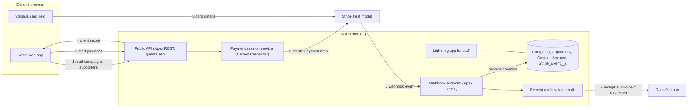
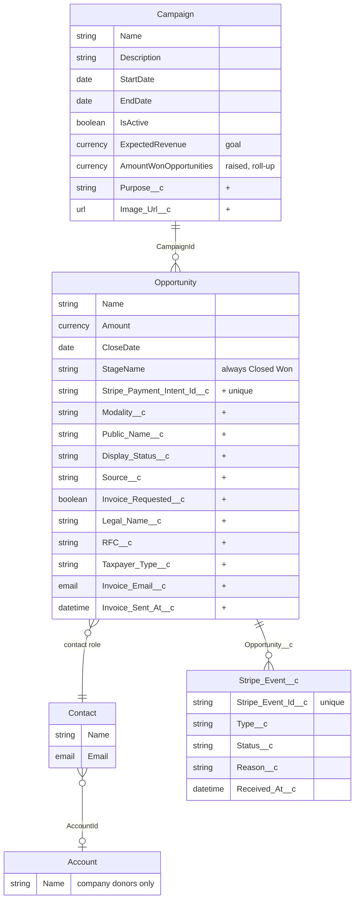

# Architecture — Solution Architecture

This document describes how the services connect and how the project's models map to Salesforce objects. It records the team's proposal and the decisions already taken; the requirements it serves live in [README.md](file:///Users/janssen/Documents/UADY/Semestre7/Salesforce/Proyecto/docs/requirements/README.md).

---

## 1. Services

| Service | Role | Hosting |
| :--- | :--- | :--- |
| **React web app** | Donor-facing site. Shows campaigns and supporters, collects donor details, and shows the Stripe card field. | Docker on a team-owned server, own domain, TLS certificate from certbot. Approved by the professor. |
| **Salesforce Developer Edition org** | Backend and database. Public API for the web app, payment sessions, webhook endpoint, emails, and the staff Lightning app. | Salesforce |
| **Stripe (Test Mode)** | Takes the card, confirms the payment, and notifies Salesforce by webhook. | Stripe |

### Payment flow
1. The web app asks the public API for open campaigns and the supporters list.
2. The donor fills in the form. The app asks for a payment session with amount, campaign, modality and donor details.
3. Salesforce creates a Stripe PaymentIntent and stores those details in its metadata. No donation record exists yet.
4. Salesforce returns the client secret to the app.
5. The card field sends the card to Stripe. Salesforce never sees card data.
6. Stripe posts `payment_intent.succeeded` to the webhook endpoint. Salesforce checks the signature, ignores events it already logged, and creates the donation. Failed payments and bad notices go to the event log only.
7. Salesforce emails the receipt.
8. Salesforce emails the invoice, only when the donor requested one.

### Decisions taken
- **Web app hosting:** outside Salesforce, on the team's server. The org allows only that origin through CORS.
- **No Pending record:** a donation is created only after a successful payment. Donor details, including the RFC, travel in the PaymentIntent metadata. This differs from `RF-D3` in `lineamientos.md` and needs the professor's confirmation.
- **Receipt by Salesforce:** Stripe sends no receipt emails in test mode, so Salesforce sends the receipt and the invoice. The Developer Edition daily email limit must be checked.
- **Donation object:** the standard Opportunity, not a custom `Donation` object.

### Open technical checks
- The Guest User can call the Apex REST API from the team's origin (CORS on a public site).
- The webhook endpoint is reachable by Stripe through the public site.
- The Developer Edition daily email limit covers the demo.
- Whether the E1 deliverable confirms the payment without the webhook (for example, Salesforce asks Stripe for the payment status when the donor returns). Recording must be idempotent on the Stripe payment ID so both paths can coexist.

---

## 2. Data Model

Standard objects are reused wherever one fits. Custom fields on standard objects are marked `+`.

`Banned_Word__mdt` (custom metadata, field `Word__c`) holds the words refused in public names. Who maintains the list is still an open point.

| Project term | Salesforce | Note |
| :--- | :--- | :--- |
| Campaign, goal, dates | Campaign | Goal in `ExpectedRevenue`. Completed means the end date passed or the raised amount reached the goal. |
| Donation | Opportunity | Staff-entered donations use the same object with `Source__c` = Manual. |
| Donor, company | Contact, Account | Matched by email to avoid duplicates. Anonymous donors keep their email, which is never public. |
| Progress toward goal | Campaign roll-up | Simultaneous payments both count, so a campaign can end above 100%. |
| Anonymous, Credited, Invoiced | `Modality__c` | The supporters list shows Credited and Invoiced donations that are Visible. |
| Hide or correct a name | `Public_Name__c`, `Display_Status__c` | Hidden donations still count toward the goal. |
| Invoice request | `Invoice_*` fields, `RFC__c`, `Legal_Name__c` | Fields on the donation. No separate object, since each donation has at most one invoice. |
| Notice log, duplicate check | `Stripe_Event__c` | The only custom object. No standard object holds a staff-readable integration log. |
| Donation entry, moderator | Permission sets | The Guest User gets no permissions on these objects. |
