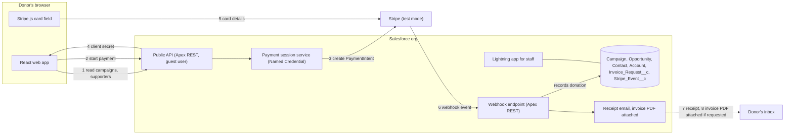
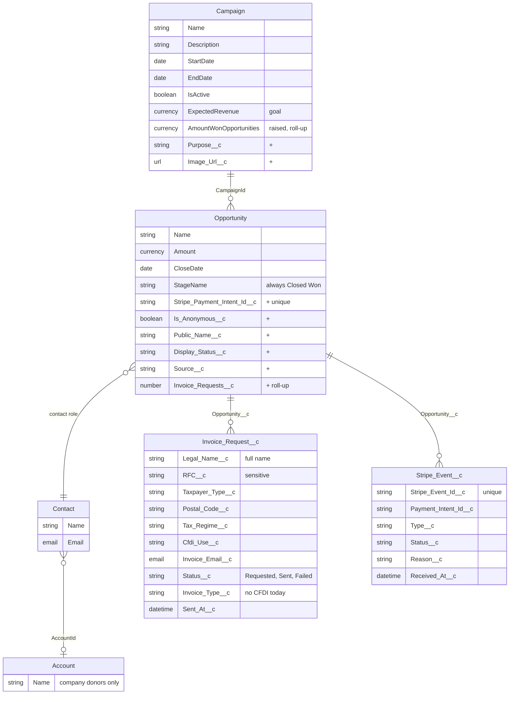

# Architecture — Solution Architecture

This document describes how the services connect and how the project's models map to Salesforce objects. It records the team's proposal and the decisions already taken; the requirements it serves live in [README.md](file:///Users/janssen/Documents/UADY/Semestre7/Salesforce/Proyecto/docs/requirements/README.md).

---

## 1. Services

| Service | Role | Hosting |
| :--- | :--- | :--- |
| **React web app** | Donor-facing site. Shows campaigns and supporters, collects donor details, and shows the Stripe card field. | Docker on a team-owned server, own domain, TLS certificate from certbot. Approved by the professor. |
| **Salesforce org (class Enterprise Edition sandbox)** | Backend and database. Public API for the web app, payment sessions, webhook endpoint, emails, and the staff Lightning app. | Salesforce |
| **Stripe (Test Mode)** | Takes the card, confirms the payment, and notifies Salesforce by webhook. | Stripe |

### Payment flow
1. The web app asks the public API for open campaigns and the supporters list.
2. The donor fills in the form. The app asks for a payment session with amount, campaign, recognition choice, invoice choice and donor details.
3. Salesforce creates a Stripe PaymentIntent and stores those details in its metadata. No donation record exists yet.
4. Salesforce returns the client secret to the app.
5. The card field sends the card to Stripe. Salesforce never sees card data.
6. Stripe posts `payment_intent.succeeded` to the webhook endpoint. Salesforce checks the signature, ignores events it already logged, and creates the donation. Failed payments and bad notices go to the event log only.
7. Salesforce emails the receipt.
8. When the donor requested an invoice, the same email carries the simulated invoice PDF and is copied to the invoice address when it differs.

### How Salesforce knows who a donation belongs to
The display name and the invoice data are separate: the first exists only for credited donors, the second only when an invoice is requested. The donor details are validated in step 2 and attached to the PaymentIntent as metadata in step 3. The `payment_intent.succeeded` event in step 6 carries the full PaymentIntent, so the webhook has everything it needs without a stored draft.

The exact keys, values and rules are defined in [contract.md](file:///Users/janssen/Documents/UADY/Semestre7/Salesforce/Proyecto/docs/contract.md) (section 4), which is the single source. In short: campaign, anonymity flag, donor email and invoice flag always; the display name only for credited donors; the seven invoice items only when an invoice is requested.

On `payment_intent.succeeded`, Salesforce verifies the signature, then in one transaction:
1. Finds or creates the Contact by email, and the Account when the invoice's taxpayer type is a company. The Contact is named from the invoice legal name, else the display name, else "Anonymous donor".
2. Creates the Opportunity (Closed Won) with the campaign, the amount from the event, the anonymity flag and the PaymentIntent ID.
3. Creates the `Invoice_Request__c` when the metadata carries invoice data.
4. Logs the event in `Stripe_Event__c`, then queues the donor email: the receipt, with the simulated invoice PDF attached when requested (`RF-F3`). A finalizer marks the invoice request Sent or Failed after the job ends. The queued job (`DonationEmailJob`) runs after the transaction commits, so an email failure never undoes the donation or makes Stripe retry, and a repeated notice queues nothing.

Why this is safe and where it stops:
- The browser holds only the client secret. It can confirm the payment but cannot change the metadata or the amount, so Salesforce trusts what it validated itself.
- Stripe allows 50 metadata keys, 500 characters per value; these fields fit.
- The details stay in Stripe's test account, so only fictitious data is allowed.
- If creating the records fails, the endpoint answers with an error so Stripe retries. The unique PaymentIntent ID on the Opportunity makes the retry safe.
- The shared class sandbox has a pre-existing legacy Opportunity trigger. Its org-admin-authorized compatibility guard skips its fund rollup when `FONDOS SDU` is absent, allowing this portal's recording transaction to complete. When that legacy campaign exists its previous calculations remain unchanged; cross-project fund attribution still requires coordination (security risk R9). This compatibility metadata is specific to the teaching sandbox and is not a new portal data model requirement.
- Returning donors can also reach the existing `PreApproveStudent` trigger through NPSP updates to CampaignMember totals. Its `CampaignMemberTriggerHandler` now ignores updates that do not change scholarship approval and skips the optional fund when absent. Approval/reversal calculations remain unchanged when the fund exists. This second teaching-sandbox compatibility guard grants no guest permissions and does not change the portal's payment or invoice contract.

### Decisions taken
- **Web app hosting:** outside Salesforce, on the team's server. The org allows only that origin through CORS.
- **No Pending record:** a donation is created only after a successful payment. Donor details, including the RFC, travel in the PaymentIntent metadata. This differs from `RF-D3` in `lineamientos.md`; the professor confirmed it is acceptable and that the guideline's wording was wrong.
- **Receipt by Salesforce:** Stripe sends no receipt emails in test mode, so Salesforce sends the receipt, with the invoice attached when requested. The org allows 5,000 single emails a day (Enterprise Edition sandbox, checked 2026-11-17).
- **Site language and currency:** the site and emails are in Spanish; amounts are in MXN, with a 50 MXN minimum and no maximum.
- **Campaigns stay open past 100%:** a campaign closes only on its end date.
- **Donation object:** the standard Opportunity, not a custom `Donation` object.
- **Invoice as its own object:** `Invoice_Request__c` is a child of the donation, for its own status, reissues and RFC isolation.
- **No Payment object for now:** a donation exists only after one successful payment, so it has one PaymentIntent. `Stripe_Event__c` keeps the attempt history. A Payment object becomes worthwhile if refunds, stored failed attempts, or more Stripe data (charge, fees) enter scope.

### Open technical checks
How each is set up and tested, with fallbacks: [salesforce-api.md](file:///Users/janssen/Documents/UADY/Semestre7/Salesforce/Proyecto/docs/salesforce-api.md).
- ~~The Guest User can call the Apex REST API from the team's origin (CORS on a public site).~~ Confirmed on 2026-11-06 ([salesforce-api.md](../../salesforce-api.md), section 4).
- The webhook endpoint is reachable by Stripe through the public site.
- The daily single-email limit covers the demo: the project org (`uady--class2026h`) is an Enterprise Edition sandbox with 5,000 single emails a day, checked on 2026-11-17 with `sf org list limits`. Still open: the org's deliverability must be **All email** and an org-wide sender address must exist (none yet) (#47).
- Resolved by the delivery plan: E1 records donations from a sample event, E2 connects the real webhook. Earlier open question: whether the E1 deliverable confirms the payment without the webhook (for example, Salesforce asks Stripe for the payment status when the donor returns). Recording must be idempotent on the Stripe payment ID so both paths can coexist.

---

## 2. Data Model

Standard objects are reused wherever one fits. Custom fields on standard objects are marked `+`.

`Banned_Word__mdt` (custom metadata, field `Word__c`) holds the words refused in display names. Moderators and admins maintain the list.

| Project term | Salesforce | Note |
| :--- | :--- | :--- |
| Campaign, goal, dates | Campaign | Goal in `ExpectedRevenue`. Completed means the end date passed; reaching the goal does not close a campaign. |
| Donation | Opportunity | Staff-entered donations use the same object with `Source__c` = Manual. |
| Donor, company | Contact, Account | Matched by email to avoid duplicates. Anonymous donors keep their email, which is never public. |
| Progress toward goal | Campaign roll-up | Simultaneous payments both count, so a campaign can end above 100%. |
| Anonymous or credited | `Is_Anonymous__c` | Two independent choices with the invoice request. The supporters list shows donations that are not anonymous and are Visible. |
| Hide or correct a name | `Public_Name__c`, `Display_Status__c` | Hidden donations still count toward the goal. |
| Invoice request | `Invoice_Request__c` | Child of the donation. Has its own status, can be reissued (1 donation to N invoices), keeps the RFC behind its own permission set, and avoids empty invoice fields on most donations. The roll-up `Invoice_Requests__c` on the donation counts its requests, so the donations list shows and filters whether an invoice was requested without exposing the RFC. `Invoice_Type__c` leaves room for CFDI later. The donor gives five SAT items (full name, RFC, postal code, fiscal regime, fiscal use); the invoice fills in the rest (description, quantity 1, amount, single payment, card) from the donation. |
| Notice log, duplicate check, attempt history | `Stripe_Event__c` | Logs every Stripe notice, including failed payments, with the PaymentIntent ID. No standard object holds a staff-readable integration log. |
| Admin, campaign manager, moderator | Three permission sets | See [roles.md](file:///Users/janssen/Documents/UADY/Semestre7/Salesforce/Proyecto/docs/requirements/admin/roles.md). The Guest User gets no permissions on these objects. |
