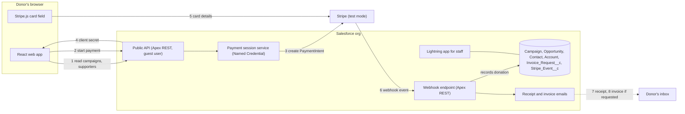
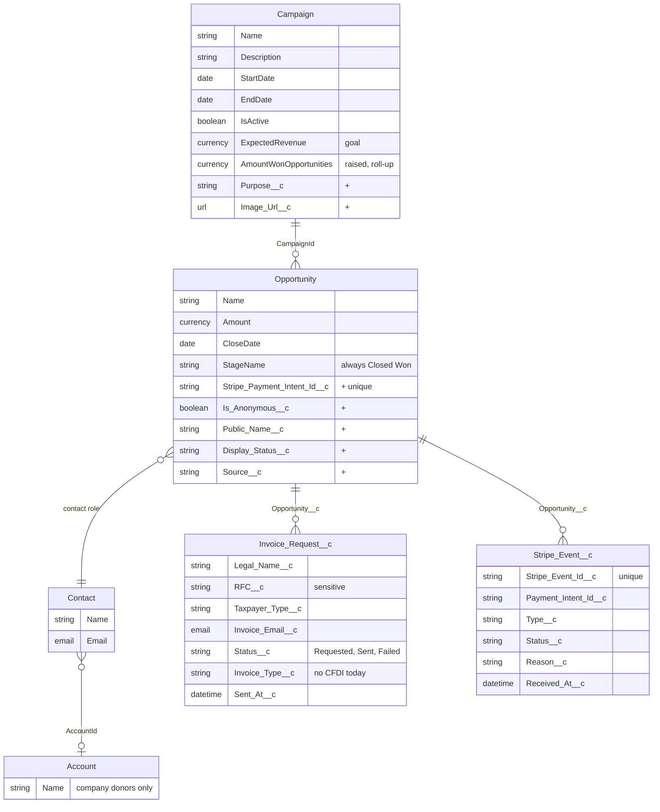

# Architecture — Solution Architecture

This document describes how the services connect and how the project's models map to Salesforce objects. It records the team's proposal and the decisions already taken; the requirements it serves live in [README.md](file:///Users/janssen/Documents/UADY/Semestre7/Salesforce/Proyecto/docs/requirements/README.md).

---

## 1. Services

| Service | Role | Hosting |
| :--- | :--- | :--- |
| **React web app** | Donor-facing site. Shows campaigns and supporters, collects donor details, and shows the Stripe card field. | Docker on a team-owned server, own domain, TLS certificate from certbot. Approved by the professor. |
| **Salesforce Developer Edition org** | Backend and database. Public API for the web app, payment sessions, webhook endpoint, emails, and the staff Lightning app. | Salesforce |
| **Stripe (Test Mode)** | Takes the card, confirms the payment, and notifies Salesforce by webhook. | Stripe |

### Payment flow
1. The web app asks the public API for open campaigns and the supporters list.
2. The donor fills in the form. The app asks for a payment session with amount, campaign, recognition choice, invoice choice and donor details.
3. Salesforce creates a Stripe PaymentIntent and stores those details in its metadata. No donation record exists yet.
4. Salesforce returns the client secret to the app.
5. The card field sends the card to Stripe. Salesforce never sees card data.
6. Stripe posts `payment_intent.succeeded` to the webhook endpoint. Salesforce checks the signature, ignores events it already logged, and creates the donation. Failed payments and bad notices go to the event log only.
7. Salesforce emails the receipt.
8. Salesforce emails the invoice, only when the donor requested one.

### How Salesforce knows who a donation belongs to
The donor details are validated in step 2 and attached to the PaymentIntent as metadata in step 3. The `payment_intent.succeeded` event in step 6 carries the full PaymentIntent, so the webhook has everything it needs without a stored draft.

| Metadata key | Used for | When |
| :--- | :--- | :--- |
| `campaign_id` | Opportunity `CampaignId` | Always |
| `is_anonymous` | `Is_Anonymous__c` | Always |
| `invoice_requested` | Whether to create an `Invoice_Request__c` | Always |
| `donor_email` | Find or create the Contact; receipt address | Always |
| `donor_name` | Contact name; for an anonymous donor who requests an invoice, the invoice legal name | Credited, or invoice requested |
| `public_name` | `Public_Name__c` | Credited |
| `is_company` | Create or link the Account | Credited, or invoice requested |
| `invoice_legal_name`, `invoice_rfc`, `invoice_taxpayer_type`, `invoice_email` | `Invoice_Request__c` | Invoice requested |

On `payment_intent.succeeded`, Salesforce verifies the signature, then in one transaction:
1. Finds or creates the Contact by email, and the Account for a company.
2. Creates the Opportunity (Closed Won) with the campaign, the amount from the event, the anonymity flag and the PaymentIntent ID.
3. Creates the `Invoice_Request__c` when the metadata carries invoice data.
4. Logs the event in `Stripe_Event__c`, then sends the receipt and, if requested, the invoice.

Why this is safe and where it stops:
- The browser holds only the client secret. It can confirm the payment but cannot change the metadata or the amount, so Salesforce trusts what it validated itself.
- Stripe allows 50 metadata keys, 500 characters per value; these fields fit.
- The details stay in Stripe's test account, so only fictitious data is allowed.
- If creating the records fails, the endpoint answers with an error so Stripe retries. The unique PaymentIntent ID on the Opportunity makes the retry safe.

### Decisions taken
- **Web app hosting:** outside Salesforce, on the team's server. The org allows only that origin through CORS.
- **No Pending record:** a donation is created only after a successful payment. Donor details, including the RFC, travel in the PaymentIntent metadata. This differs from `RF-D3` in `lineamientos.md` and needs the professor's confirmation.
- **Receipt by Salesforce:** Stripe sends no receipt emails in test mode, so Salesforce sends the receipt and the invoice. The Developer Edition daily email limit must be checked.
- **Site language and currency:** the site and emails are in Spanish; amounts are in MXN, with a 50 MXN minimum and no maximum.
- **Campaigns stay open past 100%:** a campaign closes only on its end date.
- **Donation object:** the standard Opportunity, not a custom `Donation` object.
- **Invoice as its own object:** `Invoice_Request__c` is a child of the donation, for its own status, reissues and RFC isolation.
- **No Payment object for now:** a donation exists only after one successful payment, so it has one PaymentIntent. `Stripe_Event__c` keeps the attempt history. A Payment object becomes worthwhile if refunds, stored failed attempts, or more Stripe data (charge, fees) enter scope.

### Open technical checks
- The Guest User can call the Apex REST API from the team's origin (CORS on a public site).
- The webhook endpoint is reachable by Stripe through the public site.
- The Developer Edition daily email limit covers the demo.
- Whether the E1 deliverable confirms the payment without the webhook (for example, Salesforce asks Stripe for the payment status when the donor returns). Recording must be idempotent on the Stripe payment ID so both paths can coexist.

---

## 2. Data Model

Standard objects are reused wherever one fits. Custom fields on standard objects are marked `+`.

`Banned_Word__mdt` (custom metadata, field `Word__c`) holds the words refused in public names. Who maintains the list is still an open point.

| Project term | Salesforce | Note |
| :--- | :--- | :--- |
| Campaign, goal, dates | Campaign | Goal in `ExpectedRevenue`. Completed means the end date passed or the raised amount reached the goal. |
| Donation | Opportunity | Staff-entered donations use the same object with `Source__c` = Manual. |
| Donor, company | Contact, Account | Matched by email to avoid duplicates. Anonymous donors keep their email, which is never public. |
| Progress toward goal | Campaign roll-up | Simultaneous payments both count, so a campaign can end above 100%. |
| Anonymous or credited | `Is_Anonymous__c` | Two independent choices with the invoice request. The supporters list shows donations that are not anonymous and are Visible. |
| Hide or correct a name | `Public_Name__c`, `Display_Status__c` | Hidden donations still count toward the goal. |
| Invoice request | `Invoice_Request__c` | Child of the donation. Has its own status, can be reissued (1 donation to N invoices), keeps the RFC behind its own permission set, and avoids empty invoice fields on most donations. `Invoice_Type__c` leaves room for CFDI later. |
| Notice log, duplicate check, attempt history | `Stripe_Event__c` | Logs every Stripe notice, including failed payments, with the PaymentIntent ID. No standard object holds a staff-readable integration log. |
| Admin, campaign manager, moderator | Three permission sets | See [roles.md](file:///Users/janssen/Documents/UADY/Semestre7/Salesforce/Proyecto/docs/requirements/admin/roles.md). The Guest User gets no permissions on these objects. |
